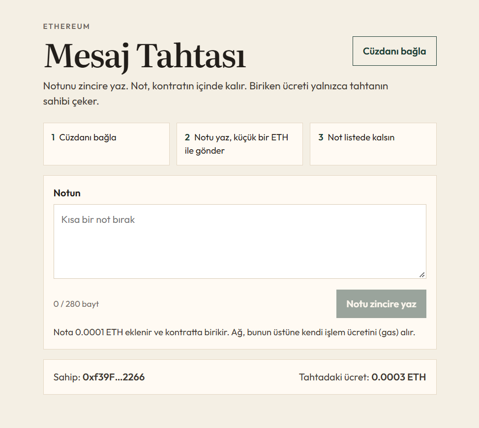
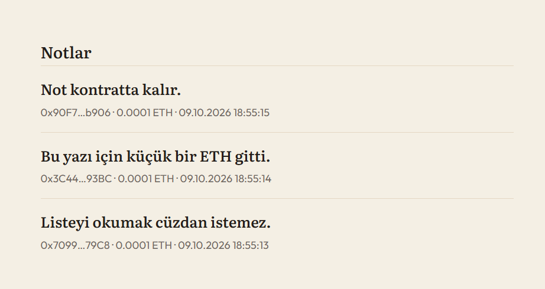

# Mesaj Tahtası

Ethereum üzerinde küçük bir not panosu. Cüzdanla bağlanırsın, notunla birlikte küçük bir ETH gönderirsin, not kontratın içinde kalır. Biriken ücreti yalnızca tahtayı deploy eden adres çekebilir.

Bu, portfolyoda şunu göstermek için duruyor: cüzdan, akıllı kontrat, zincirde duran veri, sahip yetkisi ve gas ile ödeme arasındaki fark.





## Nasıl anlatılır

Kullanıcı MetaMask ile bağlanıyor, not yazarken kontrata ETH gönderiyor. Notlar kontratın belleğinde duruyor. Ücreti sadece deploy eden adres çekebiliyor; bunu test de doğruluyor. Notları okumak ücretsiz bir `view` çağrısı, yazmak ise cüzdanın imzaladığı bir işlem.

Şunlara dayan:

- Kural arayüzde değil, `contracts/MessageBoard.sol` içinde.
- `msg.sender` notu yazan kişidir. `owner` kontratı deploy eden kişidir.
- `0.0001 ETH` nota eklenen ücrettir ve kontratta birikir.
- Gas ayrıdır. Ağı çalıştıranlara ödenir, tahtanın bakiyesine girmez.
- `withdraw` başkasına açıksa işlem geri döner. Notlar silinmez.

## Çalıştırma

İki terminal aç. Birincide:

```powershell
npm install
npm test
npm run node
```

İkinci terminal:

```powershell
npm run deploy:local
npm run dev
```

Tarayıcıda `http://127.0.0.1:5173` açılır. MetaMask'ta yerel ağı ekle:

- Ağ adı: Hardhat Local
- RPC: `http://127.0.0.1:8545`
- Zincir numarası: `31337`
- Sembol: ETH

Hardhat'in ilk hesabı tahtanın sahibidir. Bu anahtar herkese açıktır; yalnızca kendi bilgisayarındaki yerel ağda kullan. Mainnet'e veya gerçek paraya koyma.

- Adres: `0xf39Fd6e51aad88F6F4ce6aB8827279cffFb92266`
- Özel anahtar: `0xac0974bec39a17e36ba4a6b4d238ff944bacb478cbed5efcae784d7bf4f2ff80`

Bu hesabı içe aktarırsan ücreti çekme düğmesini de görürsün. Başka bir hesapla girersen düğme görünmez; kontrat çekmeye izin vermez.

`npm run node` kapanınca yerel zincir silinir. Tekrar deploy etmek gerekir.

## Herkese açık deneme (Sepolia)

Canlı link istiyorsan Sepolia test ağı yeter. Gerçek ETH gerekmez.

1. `.env.example` dosyasını `.env` yap.
2. MetaMask'tan bir test hesabının özel anahtarını `PRIVATE_KEY` alanına yaz. Bu hesabı başka yerde kullanma.
3. [Sepolia musluğu](https://cloud.google.com/application/web3/faucet/ethereum/sepolia) ile o hesaba test ETH al.
4. `npm run deploy:sepolia` çalıştır.
5. `npm run dev` ile sayfayı aç, MetaMask'ta Sepolia'yı seç.

Deploy, sayfanın okuduğu kontrat adresini `frontend/src/config.js` içine yazar.

## Dosyalar

- `contracts/MessageBoard.sol` — zincirdeki kurallar
- `test/MessageBoard.js` — ücret, boş not, uzun not ve sahip çekiminin kanıtı
- `frontend/` — cüzdanın konuştuğu sayfa

## Sınır

Not listesinin tamamı tek çağrıda okunur. Birkaç not için yeter. Binlerce notta bu çağrı pahalılaşır; gerçek üründe sayfalama yapılır.
